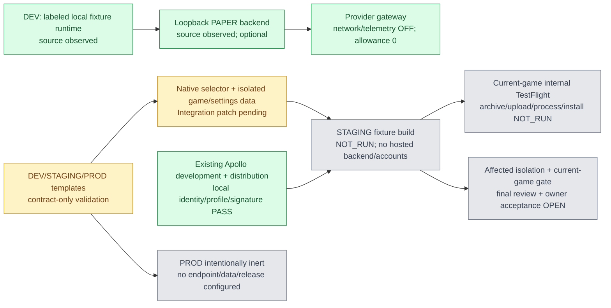

# Apollo environments lane — testing preparation

Checkpoint **2026-10-17 12:49 EDT**. Required full Apollo demo remains due **16:00 America/New_York**, with **16:00–16:30 recording/rehearsal** and **16:30 judging**. Production has no delivery deadline. Initial 20-minute result due13:02 is prepared early. This receipt concerns environment/signing preparation, not overall game acceptance.

## Binding and ownership

Source `/Users/zaccromero/code/hackathon/Apollo-Hack`, branch `feat/four-provider-ios-demo`, HEAD `b42cb5846e37da9424086876150ee26a9a61f936`; source is dirty with live unique work. Integration ledger/README read at12:42; current builders and all claims preserved. No managed claim database was created, no device/runtime lease acquired and no source reset occurred.

Receiving chat verified with `list_threads`: **Apollo — Dev, Staging & Test Signing**, ID`01a14abe-3093-7971-9ebe-02574df0bc29`, workspace `/Users/zaccromero/Documents/Codex/2026-10-17/apollo-environments-lane`; exposed session-root ID is UNKNOWN, not inferred from a chat ID. Coordinator `01a14a6f-1bfb-7000-99cb-16b6c9c876d9` selected this lane following human turn `01a14abd-a566-7a81-85d4-cd7e752c36b0` requesting dev/staging/prod and testing certificates without shipping. This lane owns only `docs/lanes/environments.md` and `config/environments/**`. Files are staged in an immutable release manifest for Integration import, because source is outside this workspace's writable roots. No shared/root/Game/project/release/keychain/provisioning file is changed.

Integration `01a14a33-e4a0-7ae1-a942-353fd5883fd3` retains sole shared configuration, certificates, uploads, canonical ledger and physical/simulator operations. New lane files do not seize any of that ownership. Cross-chat result delivery was rejected twice by automatic approval review because it did not accept historical communication authority as direct current user instructions; a direct approval question is pending. No alternate route or indirect message was used.

## Existing boundaries — observed versus proposed

| Boundary | Current evidence | Prepared testing-only behavior | Status |
|---|---|---|---|
| Native selection | Root defaults to `ApolloDemoGameService`, key `apollo.game.demo.v1`; explicit `--apollo-backend-url=` constructs HTTP service; malformed URL fails without demo substitution. No build environment selector exists. | Preserve DEV baseline. STAGING standalone fixtures in distinct namespace. PROD/unknown Release selection fail closed. | Source inspection PASS; new runtime wiring NOT_RUN |
| Native storage | Fixture paper key is separated from connected mode; optional `--apollo-test-storage=` exists. Settings namespace is injected at root. | Cover BOTH game and onboarding/settings with `apollo.stage.fixture.v1`; preserve existing demo/connected state. | Existing paths observed; cross-environment isolation NOT_RUN |
| Backend/data | Server binds127.0.0.1, default8767, default ignored `data/apollo-paper.sqlite`. Current focused8769/old8767 is Integration-reported, not probed here. No environment identity/authentication layer. | Proposed `data/dev/` and `data/staging/` paths only. No copies/resets/migrations. No hosted staging endpoint. | Source PASS; staging backend/accounts BLOCKED/unconfigured |
| Providers/secrets | `ProviderGateway` forces PRISM network/telemetry false and Nicrron disabled/paused/allowance0. Credentials can remain process-side; no keys in app contract. No credentials were read for this lane. | All provider network/spending/telemetry remain OFF. No environment pull or secret bundling. | Source inspection PASS; no paid/model calls |
| Test identity | Current fixture account is local, not a sign-in/test-user service. | Public synthetic fixture identifiers only; no private profile import. | Contracts PASS; authenticated staging accounts NOT_RUN |
| Endpoint confusion | Current root accepts any http(s) host via its explicit launch argument; template guards are not loaded. | DEV explicit loopback allowlist; STAGING no override, PROD service construction disabled. | Integration patch required; protection NOT_RUN |
| Signing | Valid local development/distribution identities; both Apollo artifact signatures verify locally. | Reuse assets; no new bundle/profile/certificate. | Local metadata/signatures PASS, installed artifact equivalence UNKNOWN |
| App record | Integration receipt reports Apollo.AI,6823998800,`com.zaccromero.ApolloHack`. | Same Apollo app/bundle; no Milo bundle/profile usage. | REPORTED; no live Apple API/browser query by this lane |
| Artifact IDs | Local simulator/device artifacts and old archive all1.0(1). Head alone cannot identify dirty game contents. | Exact source/file manifest+configuration hash+bundle/team/version/build+artifact hash. | Metadata PASS; build-number availability in Apple UNKNOWN |
| Delivery | Existing script archives only clean committed source, then internal-only export; archive/IPA is older viewer. | Clean current game gate/review then authorized internal preparation, no automatic upload. | Current archive/export/upload/processing/internal install NOT_RUN |
| Production | No PROD endpoint/account/data or real brokerage path is configured by this lane. | `prod.json`:disabled/no endpoint/no data/no signing/no delivery. | Inert contract PASS; runtime selector NOT_RUN; unshipped |

## Signing receipt — no new asset needed for proposed path

Read-only inspection used local identity listing, profile CMS decoding into memory, certificate subject/expiry extraction and local `codesign --verify --deep --strict`. No raw profile, private key, secret value, device UDID or private profile was exported. Full nonsecret receipt is `config/environments/observed-metadata.json`, observed12:43–12:47EDT.

- Team `6GB3JDVN8D`, GYM NYC LEXINGTON LLC. Development identity **Apple Development: Julio Ramos (932U4SJ492)** valid locally; certificate expires **2027-09-01 00:04:14 UTC**. Embedded wildcard development profile **iOS Team Provisioning Profile: \*** permits `6GB3JDVN8D.*`, debugger allowed, **one device**, expires **2027-09-01 00:20:39 UTC**. Actual signed Apollo app entitlement is exact `6GB3JDVN8D.com.zaccromero.ApolloHack`.
- Distribution identity **Apple Distribution: GYM NYC LEXINGTON LLC (6GB3JDVN8D)** valid locally; certificate expires **2027-10-17 14:41:02 UTC**. Profile **Apollo Hack TestFlight 20261017**, UUID`25041e1e-fd65-4c76-8c8c-e31c51aa292c`, exact allowed app`6GB3JDVN8D.com.zaccromero.ApolloHack`, debugger OFF, no device list/all-device grant, expires **2027-10-17 14:41:02 UTC**.
- Original human grant recovered from Integration human`01a14a57-799b-7a92-b101-736912e550e2`: “Yes—create the needed signing assets” in response to ONE distribution certificate+Apollo registration, preserving existing certificates. Later human Keychain approval recovered. Those actions already occurred; the grant is not an allowance for another certificate. No duplication/revocation/rotation/new asset request.
- Local blue device app at `/private/tmp/apollo-blue-phone-derived/Build/Products/Debug-iphoneos/ApolloHack.app` binary SHA256`9acbd1d694b1574381317c40d245d42ae2693cc0f61f649e0887a5abbc85d3a2`, version1.0/build1, signature PASS. This is a local file observation, not proof the current phone or later dirty source has that same binary.
- Old archive source SHA`b42cb5846e37da9424086876150ee26a9a61f936`, IPA SHA256`984529bbf1b76ea68448db7ef2f179c9bb275c7fe814df87d54d2cec36883c1f`; local signature PASS. It predates the dirty game and is provider-viewer-only. Not eligible as current-game proof.

Same-bundle development/TestFlight installations replace each other; they are not coinstalled environments. Separate fixture namespaces are required. A separate staging bundle is unnecessary for this bounded plan and would require owner-selected assets/authority if coinstallation becomes required.

Apple primary references checked2026-10-17: [App Store provisioning profile](https://developer.apple.com/help/account/provisioning-profiles/create-an-app-store-provisioning-profile) binds an explicit App ID and one distribution certificate; [internal testers](https://developer.apple.com/help/app-store-connect/test-a-beta-version/add-internal-testers) confirms an internal-only exported build can be assigned only to internal tester groups, not external testers/customers. These facts do not establish current-game upload, processing or acceptance.

## Current environment/signing map

Green=evidenced stated boundary only. Grey=unconfigured/missing/unverified. Yellow=prepared refinement awaiting integration. Edges are dependencies, not claims of deployment.

## Evals, owners and next action

| Check / observable result | Owner / timebox | State |
|---|---|---|
| Templates parse; stage/prod endpoints stay null; unsafe network/trade/upload/new-signing flags rejected; namespace/DB collisions rejected | Environments, focused contract check ≤2min | PASS, receipt accompanies release |
| Import exact new files/hashes; canonical ledger row | Integration2min after explicit manifest release | NOT_RUN; communication approval pending |
| Native DEV/STAGING/PROD selection, unknown/missing Release fail-closed, no endpoint overrides | Integration10min shared patch | NOT_RUN |
| DEV→STAGING→DEV fixture profile/watchlist/thesis/cash/history/onboarding preservation, invalid endpoint denial, paused providers | Integration8min affected-only check | NOT_RUN; no category matrix retry allowance |
| Exact clean source/config/build/signature/current game artifact, existing combined gate and final adversarial P0/P1 review | Integration existing gate/review budget | OPEN; lane contract check does not replace it |
| Apple validation, authorized upload, processing, internal install/owner acceptance separately | Integration; Apple duration UNKNOWN | NOT_RUN; no production/public/external action |

Repository README reports no established full CI/release gate; inspected authority has no gate table. `NO_LOCAL_CI_AUTHORITY_FOUND` for a canonical full gate; this lane runs only the named focused contract checks. The existing game combined gate/final review remains Integration-owned/open. Infrastructure review verdicts/consumed matrix recovery remain untouched. One scoped initial environment inspection and one scoped final contract P0/P1 check only; no subagent, broad repository audit or reviewer recursion.

16:00 risks: current source is dirty, no environment-aware native build exists, TestFlight cannot use Mac loopback launch arguments, Apple processing is unbounded, and full game acceptance still has other owners' open journeys. Environment preparation does not delay the installed blue candidate's phone/onboarding/chart/provider work. If staging integration cannot fit, report the exact missing native isolation proof and retain the working local fixture demo; reduced required scope still needs owner acceptance. Production stays unconfigured regardless of timing.

Next: Integration imports the explicit new-file manifest, wires the shared native boundary, returns actual environment/data evidence and updates the sole canonical ledger. No upload is authorized by this receipt. Preparation ready; environment runtime and overall Apollo outcome remain incomplete.

## Continuation — 2026-10-17 13:47 EDT

Direct human direction in this lane now requires actual DEV/STAGING isolation and Release guards, production OFF and current4PM blockers. Messaging authority was directly approved and result delivered to both coordinator and Integration13:31. Integration's13:17 canonical ledger records the original10-file import; all10 destination hashes independently matched13:31. Earlier import/messaging state above is historical, not current.

Integration explicitly confirmed no competing resolver and released pure Foundation helper preparation under this lane's existing config scope; it retains root/project/native tests/device/release. Frozen helper `config/environments/ApolloEnvironmentPolicy.swift` exposes enum `ApolloAppEnvironment` and struct `ApolloRuntimeConfiguration` with environment, paperStorageKey, stateNamespace, backendURL, initialComparison and diagnosticsEnabled; static `resolve(declaredEnvironment:isDebugBuild:arguments:) throws`. The file name is Policy per Integration's latest instruction; there is no duplicate RuntimeConfiguration file.

Focused helper compile + **48 guard cases PASS**. Production always throws. Unknown/blank/missing non-Debug declarations and Release DEV throw before a selection exists; staging fixes both storage bases at `apollo.stage.fixture.v1`, no backend, diagnostics or comparison, rejecting Apollo/diagnostics/environment overrides. DEV preserves exact existing paper/state/test/connected namespaces; backend override is limited to HTTP(S) localhost/127.0.0.1/::1 ports8767/8769, empty/root path, no credentials/query/fragment. `isDebugBuild` must come from compiled `#if DEBUG`, not runtime input. This is pure-policy proof; root adoption and nativeRelease denial remain NOT_RUN.

Independent **16 actual-model isolation checks PASS**, exact Game/Onboarding/Discovery source hashes unchanged pre/post compile/run. Disposable injected file storage only, no native preferences/device writes: fresh staging has no DEV data; staging writes preserve exact DEV financial/quiz/discovery bytes; profile/cash/holding/watchlist/thesis/history/quiz survive return; staging persists separately; staging quiz reset touches neither account. Evidence is in environments workspace `outputs/environment-runtime-checkpoint/`. These established component results are reused; no full-suite or matrix retry was performed.

Next required proof, Integration-owned: import frozen helper; include only helper (exclude Tests) in app target; root resolve before constructing service OR diagnostics; preserve current DEV `apollo.game.demo.v1` / `apollo.demo`; wire both game and host namespaces. Set explicit build metadata; Release staging only; verify actual build config and root rejection; exercise DEV→STAGING→DEV native financial+quiz+discovery preservation and stage reopen using synthetic test state. Never mutate the owner's normal session to satisfy a test. Existing full current-game gate/final review and clean signing/archive/export/Apple processing/internal install remain separate.

Timebox: helper released13:47 before requested13:51; Integration current frozen9 run bound through13:55:53, then actual wiring/native phase. Work-ready16:00EDT, recording/rehearsal16–16:30, judging16:30 unchanged. Production has no deadline and stays disabled. Environment source+component proof does not close overall demo acceptance.
